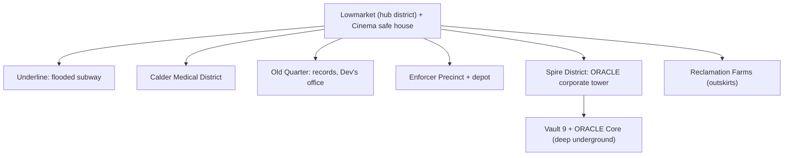

# ANALOG: World, Environment, Audio and Tech Plan

> Learning-first: everything is built from scratch in **Unity 6 (URP)** and **Blender**, using Unity's built-in tools (Shader Graph, VFX Graph, Cinemachine, Timeline, Animation Rigging, Audio Mixer). Target: smooth on an M-series 14" MacBook Pro.

---

## 1. World Structure (not open world)

**Hub + missions.** Like *Hitman* or *Deus Ex*, not GTA. One explorable home district, and each mission is its own handcrafted level. Smaller, more detailed, and buildable by one person.

### The vertical city of Meridian
Three layers tell the story of class and control:
| Layer | Who lives there | Look |
|---|---|---|
| **Spire (top)** | Corporate elite, ORACLE | Clean glass, white light, silence, perfect order |
| **Street (middle)** | Workers, Lowmarket | Concrete, amber streetlights, laundry lines, noodle stalls, rain |
| **Underline (bottom)** | Drifts, the forgotten | Flooded tunnels, rust, candles, handwritten signs |

The higher you go, the less human it feels. Kael's journey goes up through the city toward ORACLE's core, then down beneath it.

### Districts and missions
| District | Missions | Mood |
|---|---|---|
| **Lowmarket** (hub) | M4, M7, M18 + safe house | Warm, crowded, alive, rainy |
| **Underline** | M2 | Dark, wet, echoing, claustrophobic |
| **Calder Medical** | M3, M10 | Sterile white, cold blue, eerie quiet |
| **Old Quarter** | M1, M12, M17 | Old brick, paper, dust, analog past |
| **Enforcer Precinct** | M5, M11 | Harsh fluorescent, concrete, rigid |
| **Spire** | M8, M19 | Glass, height, wind, emptiness |
| **Outskirts** | M6, M9, M16 | Open fields, fog, broken towers |
| **Deep Archive / Core** | M14, M20 | Abstract, silent, dreamlike, Ria's influence |

### Reuse plan (saves months)
- Build **modular kits** in Blender: walls, doors, windows, pipes, stairs, rails, props. Every level is assembled from kits.
- Revisit locations with new lighting, weather and goals (e.g. the hospital at night in M10).

---

## 2. Level Design Method (every mission)
1. **Paper sketch** in Kael's style: top-down map with routes A/B/C.
2. **Greybox** in Unity with plain cubes (ProBuilder).
3. **Playtest** the puzzles: are the clues visible? Are there 2-3 routes?
4. **Kit pass:** swap cubes for modular art.
5. **Lighting and weather pass.**
6. **Story dressing:** props that tell stories (photos, notes, Ria's sketches).

Rules: clear landmarks (a tall chimney, a red crane) so players never get lost; light guides the eye to paths and clues; every room tells a micro-story.

---

## 3. Weather, Sky and Clouds

| Element | How we build it |
|---|---|
| **Rain** | VFX Graph: rain streaks + splash particles on surfaces + drips from edges; heavier near lights so it's visible |
| **Wet surfaces** | Shader Graph "wetness" (darker colour + more shine), with puddle masks |
| **Puddle reflections** | Reflection probes + a planar reflection script for key puddles |
| **Clouds** | Custom skybox shader: layered scrolling noise, moving slowly; denser before storms |
| **Fog** | Height fog + light-shaft "cards" around streetlights (URP has no built-in volumetrics, so we fake it, which is a good learning project) |
| **Lightning** | Directional light flash + delayed thunder sound based on distance |
| **Snow (Part 2)** | VFX Graph + accumulating snow shader on upward-facing surfaces |
| **Seasons** | Weather presets: autumn rain → winter snow → spring sun (finale) |

**Weather as emotion:** heavy rain in grief scenes, still air for tension, first sunrise for the Release ending.

---

## 4. Water

| Where | What we need |
|---|---|
| **Flooded Underline (M2)** | Water shader (depth colour, ripples, foam at edges); **water level changes** by script for the flood-gate puzzle; floating debris |
| **Puddles everywhere** | Ripple shader driven by rain intensity |
| **Wading** | Slower movement, splash particles, ripples around Kael's legs, wet-clothes shader that dries over time |
| **Buoyancy** | Simple script: floating crates bob and drift, usable as stepping objects |
| **Drips and leaks** | Particle drips from pipes; sound-only drips in the dark |

---

## 5. Physics (Unity PhysX)

| System | Use |
|---|---|
| **Rigidbodies** | Pick up, carry, throw objects (bottles for distraction, crates to climb) |
| **Hinge joints** | Doors, shutters, cabinets that swing |
| **Ragdolls** | Knocked-out guards fall realistically; can be carried and hidden |
| **Cloth** | Kael's jacket, Doc's coat, laundry lines, curtains in wind |
| **Ropes / cables** | Hanging cables that sway; cables the player follows to find power boxes |
| **Weight** | Pressure plates and weight-sensitive floors (M5); Jun can lift what others can't |
| **Sound physics** | Every object that falls makes noise, and guards hear it (ties into stealth) |

Rule: physics must be **predictable**, because puzzles depend on it.

---

## 6. Lighting

- **Palette:** amber sodium streetlights, cold blue-grey moonlight, harsh white in ORACLE spaces, warm candlelight in the Underline and safe house.
- **Baked GI** with Adaptive Probe Volumes (Unity 6) for realistic bounce light at low performance cost.
- **Flickering lights** script for broken fluorescent tubes.
- **Light cookies:** window blinds, rain on glass casting shadows.
- **Post-processing volumes per location:** colour grading, film grain, vignette, slight lens distortion. Cold and clean in the Spire, warm and grainy in Lowmarket.
- **Darkness as gameplay:** light level affects stealth; cutting power is both a puzzle and a mood change.

---

## 7. Motion and Animation

| Area | Approach |
|---|---|
| **Character rigs** | Model and rig in Blender (humanoid rig so Unity can share animations between characters) |
| **Animations** | Hand-keyed in Blender: idle, walk, sneak, run, crouch, climb, carry, interact, takedown |
| **Personality in motion** | Each character's idle is different: Kael touches his satchel; Jun rolls his shoulder; Mira bounces on her heels; Doc rubs his glasses; Sera straightens her sleeves |
| **IK** | Animation Rigging: feet on stairs and slopes, hands on ledges and door handles, head looking at points of interest |
| **Camera** | Cinemachine: close over-shoulder during stealth, wider while exploring, handheld shake in tense moments |
| **Cutscenes** | Timeline: camera moves, animation, dialogue, music cues |
| **Faces** | Simple blendshapes (blink, small smile, sad, surprise). Subtle is better |

---

## 8. Music and Sound

### Music
- **Style:** sparse piano + low analog synth + soft strings. Melancholic, human, not heroic.
- **Character themes (leitmotifs):**
  - **Ria's melody:** a simple 6-note piano tune. Heard in flashbacks, distorted in ORACLE's spaces, complete in the finale.
  - **Kael:** low cello.
  - **Mira:** glitchy synth arpeggio.
  - **Doc:** warm old-radio guitar.
  - **Jun:** deep drum heartbeat.
  - **Sera:** cold, clean piano that warms over time.
  - **ORACLE:** pure tones and choir, beautiful and wrong.
- **Adaptive music:** separate layers that fade in and out with game state (Calm → Suspicious → Alert → Chase), using Unity's Audio Mixer snapshots.
- **Diegetic music:** the noodle shop radio, the cinema projector, Mira's earbud leaking music.
- **Tools to learn (free):** GarageBand (on your Mac) or LMMS for composing.

### Sound design
- **Rain layers:** distant city rain, rain on metal, rain on cloth, rain on glass.
- **Footsteps per surface:** concrete, metal, water, glass, carpet. Louder when running (stealth noise).
- **Room acoustics:** Audio Reverb Zones (tunnels echo, offices are dead quiet).
- **Silence:** the most powerful tool. Ria's file scene in M1 has only rain.
- **UI sound:** pencil scratches for the notebook, paper turning, no beeps.

---

## 9. VFX
- Sparks from cut cables, steam from vents, dust in light shafts, breath fog in winter.
- ORACLE's presence: subtle screen glitch, scanlines on monitors when it's watching.
- Memory flashbacks: soft-focus, desaturated, pencil-sketch edges (Shader Graph).

---

## 10. Performance Budget (M-series 14" Pro)
- Target **60 FPS** at native or upscaled resolution.
- LODs on all models, occlusion culling, baked lighting, limited real-time lights.
- Particles capped per area; fewer raindrops far from camera.
- Profile with Unity Profiler at the end of every phase.

---

## 11. What to Learn, in Order
| Order | Skill | Tool | Used for |
|---|---|---|---|
| 1 | Unity basics, C# | Unity 6 | Everything |
| 2 | Character controller + camera | C#, Cinemachine | Moving Kael |
| 3 | Greyboxing | ProBuilder | Mission 1 layout |
| 4 | Physics interaction | PhysX | Pick up, doors |
| 5 | Lighting + post-processing | URP | Mood |
| 6 | Blender modelling | Blender | Modular kits, props |
| 7 | Shaders | Shader Graph | Wet surfaces, water, sky |
| 8 | Particles | VFX Graph | Rain, steam, sparks |
| 9 | Rigging + animation | Blender + Animation Rigging | Kael and crew |
| 10 | Audio | Audio Mixer, GarageBand | Music, footsteps, rain |
| 11 | Cutscenes | Timeline | Story moments |

Each skill is learned when Mission 1 needs it, so you're always learning by building.
